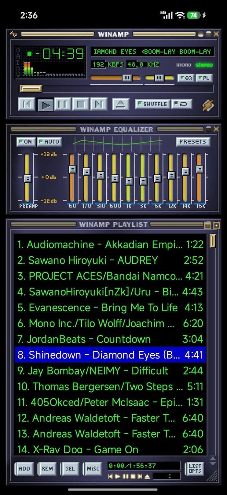
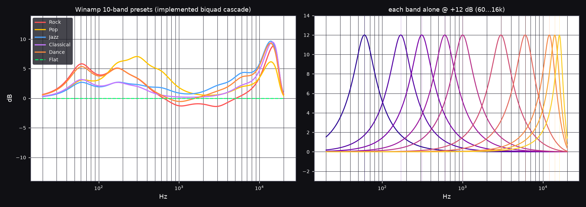

<p align="center">
  
</p>

<h1 align="center">MYXR WINAMP</h1>

<p align="center">
  在 Android 上 1:1 复刻经典 Winamp 2.x 播放器<br>
  <sub>真实 base-skin 位图 · 实时频谱 · 自研 10 段均衡器 · 播放列表</sub>
</p>

<p align="center">
  <sub><i>A pixel-perfect Winamp 2.x remake for Android — real skin bitmaps, live spectrum, a self-implemented 10-band equalizer and a full playlist editor.</i></sub>
</p>

<p align="center">
  
  
  
  
  
</p>

<p align="center">
  
  <br>
  <sub>真机截图（Redmi K100）：主窗口 / 均衡器 / 播放列表</sub>
</p>

---

## 功能特性

| | 模块 | 说明 |
|---|---|---|
| 🎨 | **像素级皮肤** | 真实 Winamp base skin 位图（14 张精灵表），整数倍缩放、关闭双线性滤波，像素边缘锐利 |
| 📊 | **实时频谱** | 柱状频谱 → 折线示波器 → 关闭，点击分析仪循环切换；PCM 直接做 FFT，不依赖系统 `Visualizer`，绕开各家 ROM 的音频链路差异 |
| 🎚 | **10 段均衡器** | 自研 DSP：解码 → 前级 → 10 个 peaking biquad → AudioTrack。频点固定为 Winamp 的 `60 / 170 / 310 / 600 / 1k / 3k / 6k / 12k / 14k / 16k`，另有 5 组预设与 AUTO 曲线 |
| 📜 | **播放列表** | ADD / REM / SEL / MISC、LIST OPTS、已选与总时长、自定义滚动条、`PLEDIT.TXT` 配色（选中行蓝底白字） |
| ▶️ | **播放控制** | 播放 / 暂停 / 停止 / 上一首 / 下一首 / 随机 / 循环 / 进度拖动 / 音量 / 平衡 |
| 🎵 | **内置歌曲** | 首次启动自动播放 `assets/wenroutaozi_Llama.wav`，可直接替换 |

> **关于均衡器**：Android 自带的 `audiofx.Equalizer` 在多数机型只有 5 段、频点由厂商决定，且可能被硬件 offload 绕过。所以本项目不用它——`PcmAudioEngine` 自己解码 PCM、自己跑 10 个 RBJ peaking 滤波器，频点和段数完全可控，前级也是滤波器链里的真增益。

<p align="center">
  
  <br>
  <sub>左：6 组预设的实际响应　·　右：每段单独 +12 dB</sub>
</p>


## 构建

无 Gradle，纯手工链路：`aapt2 → javac → d8 → zipalign → apksigner`（与 `BUILD.md` 一致）。

### 环境要求

- JDK 17（`javac` / `keytool`）
- Android SDK：`build-tools 35.0.0`、`platforms/android-35`

```bash
export ANDROID_HOME=$HOME/android-sdk
export PATH=$ANDROID_HOME/build-tools/35.0.0:$ANDROID_HOME/platform-tools:$PATH
```

### 编译与签名

```bash
AAPT2=$ANDROID_HOME/build-tools/35.0.0/aapt2
D8=$ANDROID_HOME/build-tools/35.0.0/d8
ANDROID_JAR=$ANDROID_HOME/platforms/android-35/android.jar
SRC=$(pwd)/app-src
cd $SRC
mkdir -p build/gen build/classes build/dex

# 1. 编译资源
$AAPT2 compile --dir res -o build/compiled.zip

# 2. 链接（必须带 --version-code / --version-name 和 -A assets）
$AAPT2 link -o build/app-unsigned.apk \
  --manifest AndroidManifest.xml \
  -I $ANDROID_JAR \
  --version-code 12 --version-name 0.7 \
  -A assets \
  --java build/gen \
  build/compiled.zip

# 3. 编译 Java（必须 -encoding UTF-8；JDK 17 上用 -cp，不要用 -bootclasspath）
find build/gen java -name '*.java' > build/srcs.txt
javac -encoding UTF-8 -source 8 -target 8 -cp $ANDROID_JAR \
  -d build/classes @build/srcs.txt

# 4. dex
$D8 --min-api 26 --lib $ANDROID_JAR --output build/dex \
  $(find build/classes -name '*.class')

# 5. 装进 APK，对齐，签名
cp build/app-unsigned.apk build/app.apk
(cd build && zip -j -q app.apk dex/classes.dex)
zipalign -f 4 build/app.apk build/aligned.apk
apksigner sign --ks ~/.android/debug.keystore --ks-pass pass:android \
  --out WinampClassic.apk build/aligned.apk

# 6. 验证
aapt2 dump badging WinampClassic.apk | head -5
apksigner verify WinampClassic.apk
```

产物 `app-src/WinampClassic.apk`（debug 签名，可直接安装）。仓库里已放了一份可直接安装的构建。

## 项目结构

```
MYXR_WINAMP/
├── app-src/
│   ├── AndroidManifest.xml
│   ├── assets/
│   │   ├── skin/*.bmp              # Winamp base skin 的 14 张精灵表
│   │   └── wenroutaozi_Llama.wav   # 内置默认歌曲
│   ├── java/com/dalang/winamp/
│   │   ├── MainActivity.java       # 入口、三窗口装配、播放列表持久化
│   │   ├── WinampPlayer.java       # 播放队列 / 控制 / 均衡器与音量状态
│   │   ├── PcmAudioEngine.java     # 解码 + 10 段 DSP + AudioTrack + FFT 频谱
│   │   ├── MainWindowView.java     # 主窗口：频谱、跑马灯、音量/平衡、按钮
│   │   ├── EqWindowView.java       # 均衡器窗口
│   │   ├── PlaylistWindowView.java # 播放列表窗口
│   │   ├── PlaylistAdapter.java    # 列表行（20px 行高 / PLEDIT 配色）
│   │   └── SkinAssets.java         # 精灵表加载与像素级绘制
│   ├── res/                        # 图标、主题、字符串
│   └── WinampClassic.apk           # 构建产物
├── BUILD.md                        # 手工构建链路说明
├── SPEC.md / SPEC_V2.md            # 设计与还原规格
├── screenshot.jpg                  # 真机截图
├── eq-response.png                 # 10 段均衡器实测频响
└── logo.png
```

## 开发笔记

- 无 Gradle，构建链固定为 `aapt2 → javac → d8 → zipalign → apksigner`，详见 [`BUILD.md`](BUILD.md)
- 包名 `com.dalang.winamp`，minSdk 26 / targetSdk 35
- `versionCode` / `versionName` 必须同时设置：MIUI / HyperOS 会拒装空版本号的 APK（"解析软件包出现问题"）
- 覆盖安装必须使用同一张证书；本项目使用 debug keystore（storepass / keypass 均为 `android`）
- 皮肤渲染统一走整数倍缩放 `S` 并关闭位图滤波，保证像素锐利
- 播放链路自研（`PcmAudioEngine`），不经 `MediaPlayer` / 系统 `Equalizer`；频谱与均衡器共用同一份 PCM

## 版本说明

版本号从 **v0.1 直接跳到 v0.7**，中间没有 0.2–0.6。

这几个版本号本来对应几次重做尝试，但它们都让 AI 做崩了：改一处坏一处 —— 滑杆不显示、播放列表错位、均衡器干脆不出声，没有一个能出包。

最后是 **DeepSeek-v4.1-Flash 1017** 把这几件事一起收掉的：先拿皮肤位图把每个窗口的坐标逐像素核对，再把播放链路整个重写成自研 DSP，才有了这版能在真机上跑通的构建。

所以 v0.7 不是"跳了五个小版本"，而是"0.2–0.6 全部作废，这是第一个真正能用的版本"。

## License

本项目**代码**采用 MIT License（见 [`LICENSE`](LICENSE)）。

皮肤位图等美术资源版权归 Nullsoft 所有，由 Webamp 项目分发，此处仅用于致敬与学习，不在 MIT 授权范围内。

## 致谢

- **Winamp / Nullsoft** —— 传奇的 Winamp 播放器与 base skin 美术资源（skin art © Nullsoft）
- **[Webamp](https://github.com/captbaritone/webamp)**（Jordan Eldredge，MIT License）—— 开源的 HTML5 版 Winamp。本项目的皮肤位图（`packages/webamp/assets/skins/base-2.91`）与布局 / 精灵数据（`js/skinSprites.ts`、各窗口 CSS）即从该项目提取，特此感谢
